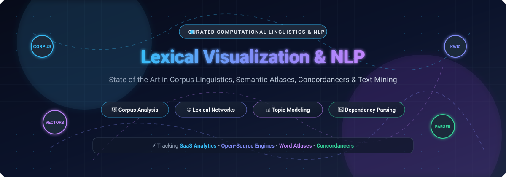

  

# Awesome Computational Linguistics & Lexical Visualization 🌐📚

  
  
  
  
  
  

---

### 📖 The State-of-the-Art in Computational Linguistics, Corpus Exploration & Lexical Atlases

> **Curated Directory of Enterprise SaaS Analytics, Academic Concordancers, Digital Humanities Engines & Open-Source NLP Toolkits**  
> *Focused on Corpus Linguistics, Semantic Atlases, Syntactic Dependency Visualizers, KWIC Concordancers, and Topic Modeling Networks.*  
> **Last updated:** November 2026 🚀

Welcome to the definitive, SEO-optimized index of **Computational Linguistics & Lexical Visualization** tools. This repository catalogues the leading hosted platforms, enterprise NLP APIs, and open-source packages for analyzing, concordancing, vectorizing, and interactively visualizing complex linguistic datasets and massive textual corpora. Whether you are conducting digital humanities research, building multilingual NLP pipelines, mapping semantic word spaces, or analyzing syntactical dependencies, this directory aggregates both commercial benchmarks and battle-tested open-source repositories.

---

## 📑 Table of Contents
- [Sector Overview & Market Dynamics 📊](#sector-overview--market-dynamics-)
- [SaaS & Hosted Platforms ☁️](#saas--hosted-platforms-️)
- [Open-Source GitHub Projects 💻](#open-source-github-projects-)
- [Star History 🌟](#star-history-)
- [How to Contribute 🤝](#how-to-contribute-)
- [Support & Community 💖](#support--community-)
- [License & Disclaimer 📜](#license--disclaimer-)

---

## Sector Overview & Market Dynamics 📊

The global Natural Language Processing (NLP) and Text Analytics market is valued at approximately **$37B–$52B** (projected to exceed **$190B+ by 2032** at a 20%+ CAGR), while specialized text analytics alone represents a **$13B–$15B** segment. The sector exhibits a **moderately concentrated infrastructure core** dominated by major cloud hyperscalers providing foundational compute and LLM APIs, contrasted with a **highly fragmented application and corpus-linguistics ecosystem** where specialized SaaS platforms, academic concordancers, and domain-tailored NLP engines capture enterprise and digital humanities workloads through unique linguistic taxonomies, syntax parsers, and custom dictionaries.

---

## SaaS & Hosted Platforms ☁️

The following table provides detailed metrics, enterprise scale, transparent entry-tier pricing, and specific free tier / trial terms for leading hosted computational linguistics and text analytics software. The table is sorted by **Company Size (Revenue / Valuation)** in descending order.

| Platform | Category & Core Focus | Company Size (Revenue / Valuation) | Pricing (Starting Tier) | Free Tier / Free Trial Limits | Official Link |
| :--- | :--- | :--- | :--- | :--- | :--- |
| **Altair AI Studio & RapidMiner** | Visual Data Science & Linguistic Mining Workflows | **$10.6B Valuation** *(~$665.8M Rev; Acquired by Siemens)* | **$10,000 / year** *(Altair Units commercial licensing)* | **Free Tier:** Permanent free edition capped at **10,000 data rows/examples per process** (manual interactive UI execution only) | [Altair](https://altair.com) |
| **Medallia (MonkeyLearn)** | No-Code Text Analytics, Topic Models & Word Clouds | **$6.4B Valuation** *(~$500M+ Rev; Acquired by Thoma Bravo)* | **$299 / month** *(Team Plan, billed annually)* | **Free Tier:** Permanent free plan with **300 queries per month** and pre-built model testing | [MonkeyLearn](https://monkeylearn.com) |
| **Quantexa (Aylien)** | News Intelligence & Multilingual Semantic Graph API | **$2.6B Valuation** *(~$161M Rev / £126.4M; Series F)* | **Custom Enterprise / ~$1,500 / month** *(News API enterprise starter)* | **Free Trial:** **14-day evaluation trial** via sales qualification with structured API volume caps | [Aylien](https://aylien.com) |
| **Reddit (MeaningCloud)** | Cloud Syntactic Parsing, Lemmatization & Topic APIs | **$10B+ Public Market Cap** *(MeaningCloud pre-acq: ~$1M Rev)* | **$99 / month** *(Basic / Start-up Plan for 120,000 requests)* | **Free Tier:** Permanent developer tier with **20,000 requests/credits per month** (rate-limited at 2 requests/second; 500 words/credit) | [MeaningCloud](https://meaningcloud.com) |
| **InMoment (Lexalytics)** | Enterprise Multilingual Syntax Parsing & Sentiment Engine | **$100M+ Est. Rev** *(Lexalytics pre-acq: ~$3.9M Rev)* | **$2,500 / month** *(Modular cloud enterprise entry tier)* | **Free Trial:** **14-day free pilot trial** with sandbox API access upon sales demonstration | [Lexalytics](https://lexalytics.com) |
| **Babel Street (Rosette API)** | Cross-Lingual Entity Resolution & Morphological NLP | **$31M–$54M Est. ARR** *(Veritas Capital portfolio company)* | **£15,000 / year** *(~$19,000 / year baseline enterprise module)* | **Free Tier:** Developer starter plan with **2,000 calls per month** (strictly capped at 500 calls/day; max 50,000 chars per doc) | [Rosette API](https://babelstreet.com) |
| **Sketch Engine (Lexical Computing)** | Cloud Corpus Manager, Word Sketches & CQL Concordancer | **~$2M–$5M Est. Rev** *(SME in Brno, Czech Republic)* | **€7.09 / month** *(Academic personal) / **€12.03 / month** (Commercial freelancer)* | **Free Trial:** **30-day unrestricted trial** with access to core functions and **1,000,000-word user corpus upload limit** (no credit card required) | [Sketch Engine](https://sketchengine.eu) |
| **Voyant Tools (Hosted)** | University-Hosted Digital Humanities Reading Environment | **Academic/Non-Profit Hosted** *(Funded by SSHRC/Universities)* | **$0.00 (100% Free)** *(Open academic infrastructure)* | **Free Tier:** **Completely free public cloud environment** supporting document uploads up to ~20MB per session | [Voyant Tools](https://voyant-tools.org) |
| **AntConc Web & CQPweb** | Academic Web-Based Corpus Concordancing Systems | **Academic/University Hosted** *(Laurence Anthony & CQP Consortium)* | **$0.00 (100% Free)** *(Freeware/Academic servers)* | **Free Tier:** **Free access** across public research installations (e.g., Lancaster University, Korp servers) | [Laurence Anthony](https://laurenceanthony.net) |

---

## Open-Source GitHub Projects 💻

The computational linguistics and lexical visualization landscape is backed by rich open-source tooling. Below are the premier open-source repositories, sorted by **GitHub_Stars (Descending)**. Each repository name includes a direct social-style badge indicating its live Stars_Count, linking directly to that repository's stargazers page.

| Repository | Live GitHub_Stars | Domain & Key Linguistic Capabilities | Framework / Language |
| :--- | :---: | :--- | :--- |
| **[spaCy](https://github.com/explosion/spaCy)** |  | Industrial-strength NLP with lightning-fast tokenization, morphological tagging, and built-in `displaCy` SVG syntactic dependency tree & named-entity visualizers. | Python / Cython |
| **[Gensim](https://github.com/piskvorky/gensim)** |  | Scalable topic modeling and semantic vector spaces implementing Word2Vec, Doc2Vec, FastText, and Latent Dirichlet Allocation (LDA). | Python / Cython |
| **[NLTK](https://github.com/nltk/nltk)** |  | Seminal computational linguistics library providing WordNet semantic taxonomy browsing, lexical dispersion graphs, frequency distributions, and stemmers. | Python |
| **[Flair](https://github.com/flairNLP/flair)** |  | Powerful PyTorch-based NLP framework for state-of-the-art multilingual sequence labeling, contextualized string embeddings, and text classification. | Python / PyTorch |
| **[Cytoscape.js](https://github.com/cytoscape/cytoscape.js)** |  | Premier graph theory and network visualization engine for rendering large-scale lexical co-occurrence networks, etymological trees, and knowledge graphs in web browsers. | JavaScript |
| **[doccano](https://github.com/doccano/doccano)** |  | Open-source text annotation tool for collaborative linguistic labeling across named entity recognition, sentiment analysis, and sequence-to-sequence translation. | Python / Vue.js |
| **[WordCloud](https://github.com/amueller/word_cloud)** |  | High-performance Python word cloud generator with mask clipping, custom color schemes, collocation detection, and publication-ready vector exports. | Python |
| **[Pattern](https://github.com/clips/pattern)** |  | Web mining and computational linguistics module with POS taggers, sentiment analysis, WordNet integration, and vector space network visualization. | Python |
| **[BERTopic](https://github.com/MaartenGr/BERTopic)** |  | Neural topic modeling utilizing transformer embeddings and c-TF-IDF to construct interactive 2D intertopic distance maps, hierarchical topic trees, and term bar charts. | Python |
| **[Stanza](https://github.com/stanfordnlp/stanza)** |  | Stanford NLP Group's official neural pipeline offering tokenization, multi-word token expansion, lemmatization, and Universal Dependencies syntactic parsing in 70+ languages. | Python / PyTorch |
| **[Gephi](https://github.com/gephi/gephi)** |  | The leading open-source network exploration software for graphing dense lexical collocations, semantic clusters, modularity classes, and sociolinguistic relations. | Java |
| **[Word Atlas](https://github.com/designfuchen/word-atlas)** |  | Interactive lexical visualization web system designed to explore semantic vocabulary spaces, word hierarchies, and lexical cartography. | TypeScript / WebGL |
| **[Polyglot](https://github.com/aboSamoor/polyglot)** |  | Multilingual natural language pipeline supporting tokenization (165 languages), language detection (196 languages), POS tagging (16 languages), and word embeddings. | Python |
| **[Scattertext](https://github.com/JasonKessler/scattertext)** |  | Specialized visualization package for discovering distinguishing linguistic features between corpora and rendering interactive, D3-powered scatter plots. | Python |
| **[pyLDAvis](https://github.com/bmabey/pyLDAvis)** |  | Python port of the R LDAvis library for interactive topic model visualization, presenting salient terms and intertopic multidimensional scaling projections. | Python / JavaScript |
| **[CLTK](https://github.com/cltk/cltk)** |  | The Classical Language Toolkit: specialized NLP pipelines, lemmatizers, and prosodic parsers for historical and ancient languages (Latin, Ancient Greek, Sanskrit, Old English). | Python |
| **[INCEpTION](https://github.com/eclipse-inception/inception)** |  | Semantic annotation and knowledge-base linking platform supporting syntactic dependency annotation, entity linking, and active learning. | Java |
| **[UDPipe](https://github.com/ufal/udpipe)** |  | Fast, trainable pipeline for tokenization, morphological tagging, lemmatization, and Universal Dependencies syntactic parsing in CoNLL-U format. | C++ / Python |
| **[HFST](https://github.com/hfst/hfst)** |  | Helsinki Finite-State Technology library for developing and compiling morphological analyzers, two-level phonology models, and finite-state transducers. | C++ / Python |
| **[Voyant Tools Engine](https://github.com/voyanttools/Voyant)** |  | Open-source server backend powering Voyant Tools with modular panels including Cirrus, Bubblelines, Trends, and Contexts KWIC viewer. | Java |
| **[Korp Frontend](https://github.com/spraakbanken/korp-frontend)** |  | Web-based corpus search interface created by Språkbanken supporting Corpus Query Processor (CQP) expressions, word pictures, and trend charts. | TypeScript / AngularJS |

---

## 🌟 Star History

---

## 🤝 How to Contribute

Contributions are warmly welcome! Help keep this computational linguistics and lexical visualization resource up to date:

1. 🍴 **Fork the repository** to your personal GitHub account.
2. 🌿 **Create a descriptive feature branch** (`git checkout -b add-linguistic-tool`).
3. 📝 **Add or edit entries in `README.md`** following the established markdown table formats. Ensure SaaS products have transparent pricing, free tier specifications, and corporate scale metrics; ensure open-source repositories include live social Stars_Badges linking to stargazers.
4. 🧪 **Check link integrity** and verify descriptions remain factual, objective, and relevant.
5. 🚀 **Submit a Pull Request** with a concise summary of changes and sources.

---

## 💖 Support & Community

If you find this curated computational linguistics catalog valuable for your research, projects, or organization, please consider supporting the project:

- ⭐ **Star this repository** to improve visibility and help other linguists and developers find it.
- 🍴 **Fork & Share** with your colleagues, university departments, and research labs on Twitter/X, LinkedIn, and Mastodon.
- ☕ **Buy me a coffee / Sponsor my work**: Your sponsorship fuels open-source maintenance, continuous ecosystem tracking, and developer tooling. Support directly via the [GitHub Sponsors Dashboard](https://github.com/sponsors/ishandutta2007)!

  

---

## 📜 License & Disclaimer

- **License:** Distributed under the [MIT License](LICENSE).
- **Disclaimer:** This repository is an independent community-curated resource. Product names, logos, and brands are property of their respective owners. Commercial pricing, subscription terms, and API limits are subject to change by vendors.
- **Corpus & NLP Best Practices:** Always respect text copyright, data privacy (GDPR/HIPAA), character encoding standards (UTF-8 normalization), and language-specific tokenization rules when harvesting and processing large-scale corpora.

---

  Built with ❤️ for computational linguists, lexicographers, NLP researchers, and digital humanists worldwide.

